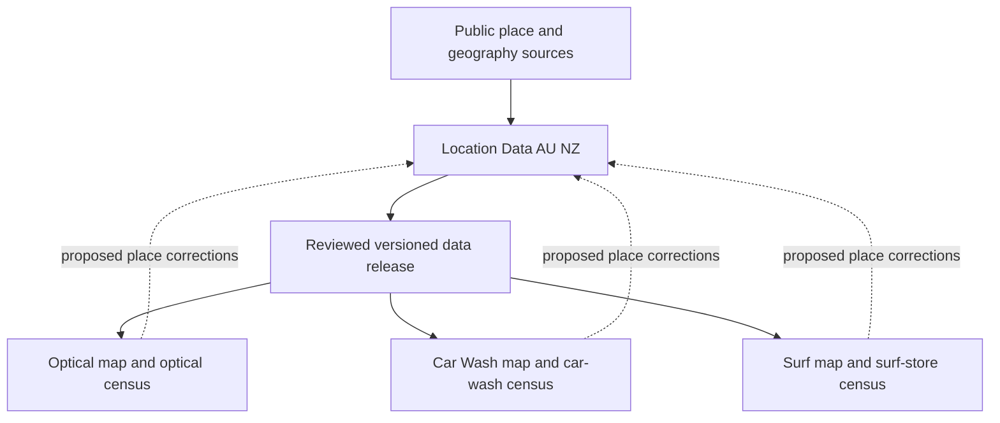

# Shared location data and industry map handover

Prepared 24 October 2026. This is the architecture and implementation handover for reusing the Optical Leasing project's public place research in AU/NZ Car Wash, Surf and future industry maps.

## Recommended setup

Use **one shared location-data project and a separate application project for each industry**. Continue optical development here. Start the shared foundation in a new sibling repository, then build Car Wash and Surf as separate consumers. Each application keeps its own business census, research rules, interface configuration and release cycle.

The reservoir should own facts about places. Each industry should own facts about its businesses and how it evaluates those places. A correction to a shopping centre's name should eventually benefit every map; a change to car-wash competition rules should affect only Car Wash.

Proposed sibling folders and repositories, not created by this handover:

```text
Location Data AU NZ/         Shared public geography, places and evidence
Optical Leasing Tool/       Existing optical application and optical census
Car Wash Intelligence/      Car-wash census and application
Surf Store Intelligence/    Surf-store census and application
```

Use each folder as its own Codex project. The folder, repository, instructions and data contracts establish the separation; a different chat title alone does not. Do not place the new projects inside this repository, copy its deployment settings into them, or use branches of this optical repository as permanent industry boundaries.



Start with versioned JSON/GeoJSON/CSV releases imported at build time. Each app pins a release and serves its own approved static files. This preserves the existing static architecture and avoids making every map depend on a new live API. A database or service can support the reservoir later if editing volume warrants it, without changing who owns each kind of fact.

## Current source position

The source is the local Optical Leasing working tree at `/Users/ayden/Documents/ChatGPT/Optical Leasing Tool`, inspected on 24 October 2026. Its branch was `codex/priority-street-enrichment`, with HEAD `a85e8ed11a85ea6411f9a24be5e128d51070a314`. It contains substantial pre-existing modified and untracked work. **That commit alone does not reproduce the inspected files.** Read the working tree and the companion [source audit](MULTI_INDUSTRY_SOURCE_AUDIT.json); preserve existing edits.

The inspected `data/retail_places.json` contains 1,549 records: 1,392 Australia and 157 New Zealand. These are observed inventory counts, not completeness targets or promised export totals. The records include centres, street corridors, terminals, precincts, arcades and other places. Three lack coordinates. The file retains 654 records whose source basis explicitly says their corridor was derived from street-front optical stores. These are useful inherited identities, but their inclusion and reference points reflect optical research coverage.

At first inspection, the place file was generated on 24 October while `data/data_health.json` was generated on 23 October. Several source datasets changed during this documentation task, and a later health file has a 24 October timestamp. Those changes were not made by this handover. The companion audit records sampled file hashes and inventory, not a frozen or transactionally consistent source backup. Its operational label does not establish validation of the extraction. No datasets were rebuilt or certified for publication as part of this documentation task. The next extraction must preserve a consistent source copy, run the required builds and tests there, and record its exact inputs before treating the snapshot or export as publishable.

The current workflow is configured to publish on a push to `main` or manual dispatch. Older handover and pilot notes contain historical branch, count and publishing-pause statements. Follow current `AGENTS.md`, the workflow and the user's current authorization; this handover authorizes no push, merge or deployment.

## What belongs in each project

| Shared location foundation | Industry application | Separate private workspace |
| --- | --- | --- |
| Canonical place identities, aliases and remaps | Business/outlet identities and operator registry | Revenue, profit, rent and lease terms |
| Public address and coordinate evidence, with point meaning and precision | Industry categories, service formats and admission rules | Negotiations, private contacts and client priorities |
| Sourced centre, street, precinct and property facts | Accepted outlet-to-place memberships | Commercial selections and derived hypotheses |
| Public ownership and management relationships | Network counts, competition, brand presence and benchmarks | Confidential reports and attachments |
| Statistical boundaries and dated demographic observations | Industry-specific source collectors and review queues | Authentication and encryption material |
| General directory observations and scoped coverage | Industry interpretation of directory observations | Any future industry-specific private analysis |
| Public transport, access and development evidence where available | Industry scoring or user-defined screening criteria | Never included in the shared public release |

Shared facts do not imply universal relevance. A centre's GLA can be shared; how strongly GLA matters for car washes is an industry decision. Income and age observations can be shared with their definitions; optical demand weights cannot.

Keep the first shared release focused on neutral place facts and general non-optical directory evidence. Optical census records, optical presence, optical reconciliation and Bailey-specific measures stay in Optical. Preserve the genuine source lineage of inherited place records even where a source is an optical retailer. Provenance is not an optical competition layer.

A directory observation can later support more than one industry, but it is not automatically a verified outlet in any industry census. If a future shared all-business registry becomes useful, add an explicit business entity layer with multiple category memberships; do not merge businesses merely because their coordinates or address match.

## Source extraction inventory

These are candidate inputs and reusable patterns, not a file-copy allowlist. Every transfer needs an explicit field projection, evidence review and output validation. Filenames such as `retail_places` and `property_intelligence` do not mean their complete contents are industry neutral.

| Existing files or components | Reuse in the foundation | Keep out or adapt |
| --- | --- | --- |
| `data/retail_places.json` | Identity, address, format, sourced public property facts and coordinate provenance | Remove `retailers`, `optical_store_count`, `has_bailey` and optical certification summaries. Reassess record scope and point basis; do not upgrade inherited confidence. |
| `data/official_retail_places.csv`; `data/place_canonical_overrides.csv`; `data/place_consolidations.csv`; `data/place_id_remaps.csv`; `data/place_suppressions.csv` | Stable identities, aliases, corrections, redirects and suppression history | Translate into a neutral identity ledger. Retain reasons and evidence; never revive a suppressed false place during a refresh. |
| `data/place_coordinate_overrides.csv`; `scripts/reviewed_place_points.py` | Coordinate review methods, receipts and reference-point semantics | `reference_store_id` can be optical-derived lineage. It must not become an unlabeled entrance, property centroid, boundary or demographic certainty. |
| `data/property_groups.csv`; `data/property_group_aliases.csv`; `data/property_group_id_remaps.csv`; `data/asset_relationships.csv`; `data/property_attributes.csv`; `data/property_research_status.csv` | Sourced public organizations, roles, property classification and research status | Review free text and field meanings. Public ownership is context, not a commercial-quality score. |
| `data/property_portfolio_assets.csv`; `data/property_portfolio_scopes.csv`; `data/property_group_domain_rules.csv` | Public portfolio evidence and its declared scope | Keep listed portfolio assets distinct from accepted canonical places; unresolved matches remain unresolved. |
| `data/property_intelligence.json` | Project only reviewed neutral relationships and property facts | Summaries, portfolios and feature vectors also contain Bailey overlap, nearest optical stores and competition. Rebuild neutral aggregates rather than copying these objects. |
| `data/public_directory_captures.json`; `scripts/public_directory_schema.py`; `scripts/retail_directory_overlay.py`; `scripts/directory_category_crosswalk.py` | Native listing IDs, public sources, original categories, literal mappings, observation dates, explicit scope and completeness | Captures contain mixed industries. Extract neutral/non-optical observations for v1; preserve source reconciliation without publishing optical module fields. Split out optical reconciliation. |
| `data/retail_environment_evidence.json`; `data/place_key_tenants.csv`; `data/place_tenants.json` | Sourced general tenant observations and scope rules | Generated tenants include optical outlets and a Bailey-derived research population. Do not copy cohort selection, optical tenants or claims of representative coverage. |
| `data/destination_directory.json`; `data/destination_research.json`; `data/destination_profile_facts.json`; `data/destination_profiles.json` | Addressed directory evidence, access, public property facts and boundary limitations | Strip optical links, competition, material optical notes and industry-specific decision prose. Counts and completeness remain source-scoped. |
| `data/retail_environments.json`; `scripts/build_retail_environments.py` | Neutral features, explicit unknowns, evidence references and coverage design | Output includes `optical`, `bn_presence`, `other_optical_presence` and `optical_reconciliation`. Build a neutral environment view. |
| `data/sa2_market.geojson`; `scripts/build_market_intelligence.py`; `scripts/market_points.py` | Australian statistical geometry and dated demographic facts; source-column validation pattern | The builder also creates optical store links and network history. Split those responsibilities. No NZ equivalent or consumer-spending dataset is established by this file. |
| `data/market_point_links.json`; `data/store_market_links.json` | Review existing join evidence as migration context | Store links belong to Optical. Rebuild shared place-area links from accepted neutral point/boundary evidence; do not inherit store-based fallbacks silently. |
| `data/growth_development_signals.csv`; `data/growth_development_signals.json`; `data/location_news_records.json`; `data/location_news.json` | Public project/event facts, dated evidence versions and place/area relationships | Review impact prose for industry interpretation. Keep direct-store relations and nearest-store helpers within an industry adapter. |
| `data/discovery/retail_places_osm_au.json`; `data/discovery/retail_places_osm_nz.json`; `data/discovery/retail_place_identity_leads.json` | Discovery provenance and candidate review methods | Raw leads are not accepted places, memberships or review failures. Keep discovery separate from the shared canonical export. |
| `data/source_manifest.json`; `data/intelligence_layer_register.csv`; `scripts/build_data_health.py` | Source freshness, explicit gaps and health-reporting patterns | Existing manifests, thresholds, certification and population are optical-specific. Create shared and industry-specific health reports. |
| `assets/app.js`; `assets/intelligence.js`; `assets/environments.js`; `assets/environment-explorer.js`; `assets/location-news.js`; `assets/styles.css` | Map interaction, filters, profiles, comparison, distance, evidence display and responsive layout patterns | Optical fetches, brand lists, scoring, wording, browser storage and share state require adapters. There is no finished generic map engine to copy unchanged. |
| `scripts/package_public_site.py`; `scripts/public_site_files.json`; `scripts/scan_public_privacy.py`; `scripts/serve_local.py` | Explicit packaging, privacy validation and safe local preview patterns | Each new app needs its own minimal public manifest and boundary checks. Never copy all of `data/`, the repository or sibling directories into a website. |
| `retailers/city-beach/`; `retailers/ozmosis/` | Surf-project discovery seeds only | Their GeoJSON metadata says Australia-only, fetched 22 June 2026. Revalidate sources, dates, stable IDs and scope. Legacy `brand_context` is not proof of current brand stockholding. |

The City Beach and Ozmosis snapshots contained 64 and 39 rows respectively at inspection. They are separate retailer maps, not a complete surf census. No current NZ surf coverage follows from them.

## Shared data contract

Define closed schemas before extraction. Use field allowlists at every nesting level, including held records, metadata and histories. A top-level deletion of optical keys is insufficient when nested competition, prose or selection fields remain.

The proposed contract has these separate entities:

| Entity | Minimum information and rule |
| --- | --- |
| Place | Stable `place_id`, name, country, administrative/locality fields, place type, explicit scope and identity status. Preserve existing accepted IDs for continuity; names and coordinates can change without changing identity. |
| Place geometry | Nullable point/boundary, geometry kind, precision, source, observed date and review status. An indicative street point is not a street extent. A missing point does not remove an otherwise accepted searchable place. |
| Identity ledger | Source namespace plus native ID; canonical ID; accepted aliases/remaps, suppressions, reason and dated evidence. Resolve redirects without loops; keep historical IDs. |
| Observation | Stable observation ID, subject, field or activity, value, unit and period where relevant, public source, publisher date, observation date, review state and limitations. Preserve conflicting observations pending a decision. |
| Directory capture | Publisher and scope, native listing IDs, source totals, extraction completeness, held records and coverage limitations. Capture completeness and physical occupancy/trading verification are different. |
| Property relationship | Place, public organization, role, validity dates, evidence and confidence. Tenant, owner, manager and nearby operator are different relationships. |
| Statistical area and link | Country, geography system/version, native area ID, geometry, metric reference year/unit and join method. Keep AU and NZ definitions separate. |
| Public event | Stable event ID, aliases, append-only evidence versions, publication date and explicit place/area relationship. Forecast dates do not prove completion. |
| Release manifest | Schema version, release ID, source-file hashes, source dates, build timestamp, coverage by country/type, unresolved counts, attribution/reuse status and changelog. |

Industry outlets reference shared `place_id` values through a separately evidenced membership table. A usable outlet can have no accepted place membership. Its coordinates still support appropriately labelled network/distance analysis, while place-specific totals require accepted membership. Distinguish verified absence, not recorded, unresolved and outside scope.

Keep raw source IDs namespaced by publisher and object type. Do not deduplicate across brands, directories or countries on name alone. Where inherited IDs are replaced, retain a complete old-to-new mapping and compatibility checks for saved selections and references.

Retain attribution and source reuse terms in the source register. Public visibility alone is not a release decision. Record missing or unresolved reuse information explicitly before distributing a dataset; carry required attribution into each consuming app.

## Updates without copies drifting apart

1. A project discovers a public place correction or addition and prepares an evidence-backed change for the shared repository. It may keep an explicit temporary local overlay pending acceptance; it must not silently rewrite its imported shared snapshot.
2. The shared repository reviews identity, scope, coordinates, provenance and public suitability. Accepted facts are maintained there once. Industry business facts remain in their industry module.
3. The shared build produces an immutable release with checksums, schema version, changelog and measured coverage. Failed collection must retain the last good snapshot, without pretending its sources were freshly checked.
4. Each application pins a release ID and imports only its allowed fields/files. The import checks checksums, schemas, ID references and country coverage. It then rebuilds its industry-derived outputs and runs its own tests.
5. An app upgrades deliberately after reviewing the changes. It can roll back to the previous compatible release. There is no background replacement with an unreviewed `latest` file.

Initially the existing Optical app continues using its current build. The new shared repository takes a controlled one-time import from a validated optical source snapshot. Car Wash is the first consumer. Once the contract works, migrate Optical through a compatibility adapter and then start Surf. After ownership transfers, accepted shared facts must no longer be independently edited in both repositories.

Do not let a shared build import the optical census or run optical builders permanently. In particular, `build_retail_places.py` currently derives some places from stores and also writes memberships, co-tenants and Bailey lookalikes; `build_property_intelligence.py` mixes public property facts with optical context. Their responsibilities must be separated, not simply renamed.

## Building the next maps

Keep the useful interaction model: map and result list, separate place/business searches, country and region filters, profiles with evidence, comparable nearby distances, saved public shortlists, site comparison, source coverage and mobile layouts. Use explicit user-selected criteria initially. Do not import Bailey benchmarks, optical demand assumptions or existing scoring weights.

An industry adapter should specify the application ID, title, business terminology, operator registry, service/category schema, source collectors, admission rules, filters, profile sections and competition settings. It should load generic place data and only that industry's census. Use a separate storage namespace such as `car-wash-au-nz:<state>:v1` or `surf-stores-au-nz:<state>:v1`, and include application/schema identity in share-state parsing. Different paths on one host can share browser storage, so namespacing is required even with separate repositories.

Extract a small reusable map shell while implementing Car Wash. Keep industry behavior behind adapters and retain focused tests. Once a second consumer demonstrates which components truly match, version the common code so bug fixes can be adopted by each application deliberately. Avoid maintaining three wholesale forks of `app.js`, but do not turn the initial handover into a complete rewrite of Optical.

| Car Wash scope to establish | Surf scope to establish |
| --- | --- |
| Fixed-location sites versus mobile-only services | Surf-specialist shops versus broader surf/lifestyle retailers |
| Self-service, automatic/in-bay, conveyor and hand-wash services; a site can offer several | Multi-brand shops, own-brand stores, factory outlets and concessions |
| Petrol-station co-location versus an independently addressed premises | Whether repair/shaping, hire-only, schools or online-only operators belong in scope |
| Detailing as a separately attributed service, not an assumption | Evidence for activity/category; a shop name or brand association alone is insufficient |
| Entrances, road access, queuing space, bays, operating hours and traffic only when sourced | Product mix, destination/visitor context and seasonal operations only when sourced |

These are proposed classification questions, not established facts or final inclusion policies. Both applications need named chains and independents, explicit AU/NZ source coverage, duplicate/closure review and visible unknowns. Nearby businesses never establish shopping-centre, petrol-station or precinct membership.

Car washes in particular must not be limited to today's shopping centres and optical-derived streets. Permit standalone business points and new evidenced places. Future road, traffic, vehicle, zoning, utility or tourism datasets need their own source review and definitions; they are not already supplied by the current place reservoir.

## Implementation sequence and acceptance

1. **Preserve the source.** Inspect current instructions and changes. In a separate local validation copy, retain the exact tracked and relevant untracked public inputs. Never use a recursive public-site copy, a reset, or the HEAD commit alone as the migration snapshot. Record hashes and resolve missing source files before proceeding.
2. **Validate the baseline.** Run the source checks below in that copy, inspect generated diffs and source-age warnings, and record pass/fail results. Do not alter evidence to reach a target count. Keep unrelated optical issues documented separately from extraction defects.
3. **Create the neutral foundation.** Add its own `AGENTS.md`, README, schemas, source register, canonical identity ledger, extraction manifest, review queue and release builder. Project fields explicitly from the inventory above. Export a reconciliation report explaining included, excluded and held records without dropping their original lineage.
4. **Prove the foundation is independent.** Build it without optical source files or optical modules available. Verify no imported UI/runtime path needs the optical repository. Source lineage may retain an original optical source reference; the runtime cannot require its census.
5. **Pilot Car Wash.** Establish scope, build a small evidence-backed census covering both countries where sources support it, and implement the map adapter. Mark uncovered regions clearly. Do not describe a pilot as an exhaustive AU/NZ census.
6. **Check industry isolation.** Inspect the generated package, data, requests, menus, URLs, downloads and browser storage. Car Wash must not load optical datasets, optical brands, Bailey filters or optical scoring. Neutral provenance is preserved rather than erased to satisfy a blanket keyword test.
7. **Check identity and evidence behavior.** Test ID/remap stability, suppressed identities, missing coordinates, uncertain membership, duplicate observations, absent-versus-unknown behavior, nested field rejection and stale-source handling. Make source and count reconciliation measurable.
8. **Verify the interface.** Exercise desktop and narrow-screen map/list filtering, country changes, profiles, nearby distances, compare, saving/reopening, empty/failure states and source coverage on the correct local checkout. Confirm AU data is never presented as NZ demographics and straight-line distance is never labelled drive time.
9. **Adopt shared releases in Optical, then Surf.** Preserve optical identity mappings and existing behavior through regression checks. Give Surf its own reviewed operator census and definitions. Publishing any new app or changing the live optical site requires explicit authorization.

Run the existing source repository's mandatory checks before certifying a baseline or export:

```sh
python scripts/build_retail_places.py
python scripts/build_property_intelligence.py
python scripts/build_data_health.py
python -m unittest discover -s tests -v
node tests/test_intelligence.js
python scripts/scan_public_privacy.py
```

Run all additional JavaScript suites present in the source checkout, including environment, map-marker, location-news, store-service, excluded-context and overview tests. Use the declared Python dependencies (`requirements.txt`) and Node environment. If source data itself is refreshed, follow the relevant source builders in README before these checks. A build timestamp does not refresh a publisher's evidence date.

Before treating a website as publishable, use a new output directory with `scripts/package_public_site.py`, scan that exact output with `scripts/scan_public_privacy.py --site <output>`, and run `git diff --check`. A passing package review does not grant deployment permission. New repositories need equivalent validation adapted to their contracts.

The handover is complete as documentation. The shared repository, release schema implementation, data extraction, new maps and migration of Optical remain the next development work. Use the [starter prompt](MULTI_INDUSTRY_STARTER_PROMPT.md) in the new Location Data AU NZ project to begin.
